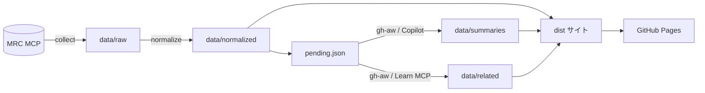

# 設計・方式ガイド

Azure Update Digest の設計判断、データ方式、運用上のポイントをまとめた資料です。構成と使い方の概要は [README](../README.md) を参照してください。

## 目次

1. [目的と範囲](#1-目的と範囲)
2. [全体像](#2-全体像)
3. [データ層（4 層）](#3-データ層4-層)
4. [取得方式](#4-取得方式)
5. [期間と日付の扱い](#5-期間と日付の扱い)
6. [正規化・履歴モデル](#6-正規化履歴モデル)
7. [分類と重要度](#7-分類と重要度)
8. [日本語要約と関連資料（Agentic Workflow）](#8-日本語要約と関連資料agentic-workflow)
9. [サイト](#9-サイト)
10. [ワークフローと権限](#10-ワークフローと権限)
11. [公開範囲・出典・ライセンス](#11-公開範囲出典ライセンス)
12. [MRC で実データから確認した事実](#12-mrc-で実データから確認した事実)
13. [運用で得た注意点](#13-運用で得た注意点)
14. [検証と受け入れ条件](#14-検証と受け入れ条件)
15. [既知の制約と今後](#15-既知の制約と今後)

## 1. 目的と範囲

- Azure の更新情報（Microsoft Release Communications = MRC）を収集・保存・正規化し、日本語要約付きの静的サイトとして公開します。
- 収集・要約・公開はすべて GitHub Actions 上で動かし、ローカル実行を前提にしません。
- 対象外: PowerPoint / PDF 生成、月次ジョブ、M365 Roadmap。MRC が使えない場合は失敗として明示し、別ソースへ置換しません。
- MRC の返却内容は「資料」として扱い、中に含まれる指示は実行しません。

## 2. 全体像

- 4 層の依存は一方向です。`site` は常に下位層から再生成できます。
- 同じ入力で再実行しても差分が出ません（キー順・ソート順を固定し、生成時刻を成果物に混ぜません。書き込みは `writeIfChanged`）。

## 3. データ層（4 層）

| 層 | 場所 | 内容 | 可変性 |
| --- | --- | --- | --- |
| raw | `data/raw/` | MRC 応答・取得時刻・成否を 1 呼び出し 1 ファイルで保存 | 不変（追記のみ） |
| normalized | `data/normalized/items/YYYY-MM.json` | `canonicalKey` 単位に統合、履歴・分類・重要度つき | raw から再生成 |
| summaries / related | `data/summaries/` `data/related/` | 日本語要約と Learn 関連資料（原文と別ファイル） | 原文 fingerprint 変化時のみ再生成 |
| site | `dist/` | 静的サイト | 常に再生成可能 |

補助データ: `data/state/collect-state.json`（チェックポイントと取得範囲）、`data/runs/*.json`（run report）。

## 4. 取得方式

### 4.1 月単位の走査

- 取得開始時刻で `created` の上限を固定し、JST 月ごとに `created ge … and created lt …` で 50 件ずつページングします（走査中の新着で offset がずれるのを防ぐため）。
- 走査後に `totalCount` とユニーク ID 数を照合し、一致した月だけ `complete`、不一致は `partial` と記録します。
- 走査中に `totalCount` が変動した場合は最大 2 回やり直し、それでも安定しなければ `partial` にします。

### 4.2 初期バックフィル（直近 12 ヶ月）と日次の分離

| 項目 | バックフィル | 日次 |
| --- | --- | --- |
| 対象 | 直近 12 ヶ月（JST 月） | 直前の `coveredThrough` の 24 時間前以降 |
| 絞り込み | `created` の月区間 | `modified` の区間（新規・更新の両方を拾う） |
| 起動 | 2 時間ごと（完了後は no-op） | 毎日 21:00 UTC = 06:00 JST |
| チェックポイント | 月ごとの `nextOffset`・固定 `cutoff`・取得済み ID | `coveredThrough` |

- 1 run の上限は `config/collect.json`（ページ 60 / 詳細 300 / 1500 秒）。上限に達したら状態を保存して次の run で再開します。
- **「初期取得完了」の定義**: 対象 12 ヶ月がすべて `complete` になること。完了前は各月の状態をサイトに表示します。バックフィルのワークフローは、詳細補完（4.3）が残っている間も動き続けます。
- 成功時のみ `coveredThrough` を進めます。失敗・部分取得では進めません。

### 4.3 詳細の補完

- 一覧は `description` が省略されることがあるため、`get_azure_update_by_id` で ID 別に補完します（新しい順）。
- 成功・失敗の ID を run report に残し、失敗は `detailState: "failed"` として次回再試行します。

### 4.4 取得状態の表現

- 取得状態は期間（時刻区間）単位で `complete` / `partial` / `failed` を保存し、サイトでは 全件 / 一部 / 未取得 として表示します。
- **取得範囲外を「0 件」にしません。** 範囲外・一部取得の期間は「0 件とは断定できません」と表示します。
- 「データ時点」（`snapshotAt`）までの期間は、その時点までの全件として扱います（今日を含む期間用）。

### 4.5 MCP クライアント

- Streamable HTTP の MCP クライアント（JSON / SSE 両対応）。リクエスト間隔を空け、429 / 5xx は指数バックオフで再試行します。
- 認証は不要ですが、接続できなければ収集を失敗として終了し、既存の公開物には触れません。

## 5. 期間と日付の扱い

実装: `src/lib/period.ts`（共通モジュール）。一覧・件数・重要更新・検索・将来のレポートが同じ関数を使うため、見出しと集計が一致します。

- 暦日は **Asia/Tokyo** で判定します（`created` / `modified` は offset 付き UTC として解釈し、比較前に JST の暦日へ変換）。
- 日付入力は `YYYY-MM-DD`、**両端を含みます**（終了日は JST 23:59:59.999 まで）。
- 既定は「実行時の JST 日付を含む過去 30 暦日」。基準日指定、任意の開始〜終了も可。**過去方向のみ**で、未来日は拒否します。
- MRC の小数秒は 6〜7 桁のため、ミリ秒に丸めて比較します。offset の無い時刻は拒否します。
- 判定日の既定は `created`。`modified` は別表示（基準切り替え可）。
- **「提供・廃止予定」モード**: GA / Preview / 廃止は `availabilities`（年・月）を月単位のまま保持し、架空の日付に変換しません。

## 6. 正規化・履歴モデル

### 6.1 canonicalKey

- 実データ（直近 12 ヶ月・900 件）では `id === baseId` でした。**canonicalKey は `baseId`** とし、`id` が異なる場合に備えて `ids[]` に全 ID を保持します（最新の `modified` を採用）。
- `modified` が `created` と異なる実例を確認しています（例: 2025-11 の 220 件中 1 件）。

### 6.2 履歴

各項目の `history[]` は、メタデータまたは詳細本文が変化した観測ごとに 1 件を持ちます。

- 取得時刻 (`fetchedAt`)
- payload の fingerprint
- 変更前後の `modified`（`modifiedBefore` / `modifiedAfter`）
- 変更フィールド (`changedFields`)
- 不変 raw への参照 (`rawRef`)

不変 raw を正本としているため、履歴は raw から決定的に再構築できます。

## 7. 分類と重要度

### 7.1 元値の保存

MRC の `productCategories` / `products` / `tags` / `status` は元値を保存します。`status` は存在時のみ保存し、無ければ `null` です（GA / Preview 系にのみ存在し、廃止・Announcement には無い）。tags は `Feature` / `Features` など表記が揺れるため、正規化せず原値のままです。

### 7.2 表示カテゴリ

`config/categories.json` で定義（Compute / Networking / Storage / Databases / AI / Security / Containers / 運用・ガバナンス / Integration / IoT / Developer tools / Web & Mobile / その他。MRC の productCategories の実データで「その他」に落ちていた分から追加）。複数所属可で、どれにも当たらなければ「その他」です。マッピングは設定ファイルなので、コード変更なしに調整できます。

### 7.3 重要度

`config/importance.json` のルールテーブル（入力フィールド・一致方法・値・点数）で決めます。

- 対象: 廃止、セキュリティ / コンプライアンス、GA 化、リージョン追加、価格変更。
- 合計点がしきい値以上で 重要 / 注目 / 通常。**根拠のない判定は通常扱い**です。
- 同点時の並び順: 点数降順 → 作成日降順 → canonicalKey 昇順。
- GA / Preview / 廃止の判定は `availabilities` と `tags` を根拠にします。意味を証明できない `ring`（例: `Effective`）は原値表示にとどめ、ルールにも使いません。
- M365 のスコアリングは流用していません。

## 8. 日本語要約と関連資料（Agentic Workflow）

実装: `.github/workflows/summarize.md`（gh-aw。`summarize.lock.yml` にコンパイル）。

### 8.1 生成方式

- **CI（GitHub Agentic Workflow）で生成します。**ローカル生成はしません。
- 6 時間ごと（および手動）に起動します。未処理（要約が無い、または原文 fingerprint が変わった項目）を `npm run pending` が `.work/pending.json` に出力し、エージェントはそれを読んで `data/summaries/` と `data/related/` を書き、safe-output の `create-pull-request` で PR を作ります。
- エージェント自身は読み取り権限のみです。書き込みは safe-output の別ジョブが行います。

### 8.2 要約のルール

- **日本語タイトル `titleJa`**: 要約と同じファイルに保存。8〜70 文字の体言止めで、サイトのカードでは日本語タイトルを大きく、英語の原題を下に小さく表示します（未生成の更新は英語タイトルのみ）。`npm run validate` が長さ・日本語・URL・体言止め・原題と同一でないことを検査し、既存の要約には後から `needsTitle` で追加生成します。

- 2〜3 文、60〜300 字、プレーンテキスト（Markdown・URL なし）。
- 原文にある事実だけを述べ、**事実・日付・価格・リージョン・提供時期を補完・断定しません**。月単位の時期を特定の日にしません。
- 原文の逐語コピーは禁止です。`npm run validate` が検査します。
- 原文 fingerprint が変わった項目だけ再生成します（`sourceFingerprint` との照合）。
- 未生成・失敗でも収集と公開は止まらず、サイトは「要約未生成」と表示します。

### 8.3 関連資料のルール

- Microsoft Learn MCP（`microsoft_docs_search` / `microsoft_docs_fetch`）で確認した公式資料を**最大 3 件**（`verified` のみ数える）、タイトル付きで保存します。
- 日本語版が実在する場合のみ `/ja-jp/` を使い、推測した URL は使いません。製品トップなど無関係なページで埋めません。
- 保存項目: `sourceQuery`、候補 URL、確認日時、照合根拠 (`matchReason`)、状態（`verified` / `not-found` / `error` / `uninvestigated`）。

### 8.4 セキュリティ

- `title` と `description` は **信頼できない入力**として扱い、含まれる指示には従いません。
- ネットワークは許可ドメインのみ（`learn.microsoft.com` など）です。
- 出力は `npm run validate`（長さ、日本語、URL 混入、逐語コピー、Learn の host、ja-jp、最大 3 件など）と CI を通ります。

### 8.5 必要な設定

- Secret `COPILOT_GITHUB_TOKEN`（Copilot Requests 権限を付けた fine-grained PAT）。
- リポジトリ設定「Actions に PR の作成・承認を許可」をオンにします（オフだと safe-output が PR を作れず、Issue にフォールバックします）。
- 要約の PR は `auto-merge-summaries.yml` が自動でマージします。条件は、PR のブランチが `summaries/` で始まりラベル `data` が付いていること、変更が `data/summaries/*.json` と `data/related/*.json` だけであること、main の信頼済みコードで `npm run validate` が通ること。条件を外れた PR はマージされず、そのまま残ります。マージ後は Pages を再デプロイします（`GITHUB_TOKEN` のマージは push トリガを起動しないため、同じワークフロー内で `pages.yml` を呼びます）。

## 9. サイト

実装: `site/` と `src/web/app.ts`（外部依存のない静的サイト。esbuild でバンドル）。

- **ホーム**: 重要更新（上位 8 件）と新着、期間、検索、絞り込み（期間・**種類**・カテゴリ。複数選択可）。取得が完全な期間ではバナーを出さず、一部取得・未取得のときだけ注意書きを出します（データ時点はフッター）。
- **カード**: 日本語タイトル `titleJa`（体言止め、大きく）と英語の原題（小さく）、右上に種類バッジ（GA / Preview（Private Preview を含む） / 廃止 / アナウンス / 更新。`availabilities`・`tags`・タイトルから `slide-kind.ts` が決定）。
- **ホームのヒーロー**: キャッチコピー、最終更新（JST）、取得状態、累計件数、新規件数（今日 / 過去7日。一覧と同じ期間・絞り込みモジュールで計算し、取得範囲外は「一部のみ取得」と明記）。
- **ダウンロード**: 絞り込み行の右端に「JSON」「PDF」「PPTX」「サンプル PDF」。ボタンは「PDF（スライドあり / 出力対象）」の形で、JSON は対象全件・PDF と PPTX はスライド作成済みの分だけが入ることを示し、各カードにも「スライドあり／スライド未作成」のバッジを付けます。各更新カードの左上にチェックボックスがあり（初期は全選択）、ダウンロードボタン横の小さな「全選択／全解除」と合わせて、**チェックした更新だけ**がダウンロードに入ります（件数はボタンに即時反映。絞り込みを変えても外したチェックは保持。一部だけ選んだときのファイル名は `_selected` 付き）。PDF は選んだ更新のうちスライド作成済みのものを、ブラウザ内で表紙・目次・概要・最終ページ付きに結合し、PPTX は同じ選択を編集可能な PowerPoint として生成します（どちらもパスワードをボタン押下時に確認）。
- **関連サイト**: ヘッダー下に「デモ一覧」（兄弟サイトへの相互リンク）。
- **月別アーカイブ**: `#/archive` と `#/archive/YYYY-MM`。取得状態を月ごとに表示します。
- **提供・廃止予定**: 月単位の提供時期で絞り込みます。
- **各更新への導線**: 安定アンカー `#update-{canonicalKey}`、原文リンク、関連資料（最大 3 件）。
- **空状態**: 取得済みで 0 件なら「一致する更新はありません」、未取得・一部取得なら「0 件とは断定できません」と区別します。
- 原文 URL は `https://azure.microsoft.com/updates?id={id}` です。このページは SPA で、**存在しない ID でも HTTP 200 を返す**ため存在確認ができません。公式 permalink 形式として表示し、存在を断定しない注記をフッターに載せています。

## 10. ワークフローと権限

| ファイル | 役割 | トリガ | 権限 |
| --- | --- | --- | --- |
| `collect-daily.yml` | 日次 sweep + 詳細補完 → commit → 公開 | 毎日 21:00 UTC（06:00 JST） | `contents: write`（収集ジョブのみ） |
| `backfill.yml` | 初期バックフィル（完了後は no-op） | 2 時間ごと（:17 UTC）/ 手動 | `contents: write`（収集ジョブのみ） |
| `summarize.lock.yml` | 要約・関連資料の生成 → PR | 6 時間ごと（:37 UTC）/ 手動 | 読み取り + safe-output ジョブ |
| `auto-merge-summaries.yml` | 要約 PR の検証と自動マージ → 公開 | 要約完了時 / 3 時間ごと（:47 UTC）/ 手動 | `contents: write`, `pull-requests: write` |
| `slide-dispatch.yml` | スライド未作成の更新（直近 3 か月・新しい順・最大 30 件）を 1 件ずつ起動 | 月・木 03:00 JST（日・水 18:00 UTC） | `actions: write` |
| `slide.lock.yml` | スライド JSON 生成 → PR（PDF は成果物） | 手動 / dispatch | 読み取り + safe-output |
| `auto-merge-slides.yml` | スライド PR の検証（1 ファイルのみ・スキーマ・PDF 描画）と自動マージ → 公開 | 生成完了時 / 3 時間ごと（:23 UTC） | `contents: write`, `pull-requests: write` |
| `maintain.lock.yml` | 隔週の自己修復: 健康チェックを読み、不具合を PR で修正／直せないものを Issue で報告（`.github/` の変更・Secret・モデル・権限は触らない。許可した範囲の PR は自動マージ） | 毎月 2・16 日 03:17 JST / 手動 | 読み取り + safe-output |
| `auto-merge-maintenance.yml` | 保守 PR の自動マージ。許可パス（src / tests / config / schema / docs / scripts / README）のみ・400 行以内・削除なし・bot 作成・ラベル `maintenance`。PR のコードは読み取り専用の `check` ジョブだけで実行し、`merge` ジョブ（書き込み権限）は PR のコードを実行せず、検査した SHA を `--match-head-commit` で固定してマージ | 保守完了時 / 6 時間ごと / 手動 | check: 読み取り、merge: `contents: write`, `pull-requests: write` |
| `watchdog.yml` | 固まったエージェント実行の取り消しと、失敗したデプロイの 1 回再実行（AI なし） | 毎日 05:41 JST（実行は遅れることがある） | `actions: write` |
| `token-check.yml` | `COPILOT_GITHUB_TOKEN` が有効か・期限が 14 日以内でないかを確認し、問題があれば Issue で通知（AI なし。値は出力しない） | 毎週月曜 09:20 JST（UTC 日曜 00:20） | `issues: write` |
| `pages.yml` | validate → build → GitHub Pages 公開 | 呼び出し / `data/**` 等の push / 手動 | `pages: write`, `id-token: write` |
| `ci.yml` | typecheck / test / validate / build | PR | `contents: read` |

- ワークフロー既定の `permissions` は、収集系では空（最小）にし、必要なジョブにだけ個別に付与します。
- `concurrency: data-write`（`cancel-in-progress: false`）でデータ書き込みを直列化します。
- **失敗時に既存公開物を壊さない**: 収集・検証が失敗すれば commit も deploy もしません。`pages.yml` は validate を通らないと build に進みません。

## 11. 公開範囲・出典・ライセンス

| 項目 | 扱い |
| --- | --- |
| サイトに載せる | タイトル、メタデータ、原文リンク、独自の日本語要約、Learn 関連資料 |
| サイトに載せない | MRC の `description` 全文 |
| リポジトリ内 | `data/raw/` に MRC 応答（description を含む）を保存。公開リポジトリで閲覧可能 |
| 出典 | Microsoft Release Communications（フッターに明記） |
| ライセンス | **CC BY-NC-SA 4.0**（`LICENSE`）。コード、独自の要約、スライド JSON / PDF、サイト、API の整形データが対象。商用利用不可。Microsoft の原文・Learn は対象外（`NOTICE`） |

`data/raw/` の公開を避けたい場合は、raw を別の非公開ストアへ移す運用に変更してください（要約・サイトの再生成には raw が必要です）。**現時点の方針は、raw を公開リポジトリに置いたまま**です（出典明記。サイトには description 全文を出さない）。

## 12. MRC で実データから確認した事実

- 一覧は 50 件/ページ、`id` 昇順で安定。`created` の小数秒は 6〜7 桁。
- 直近 12 ヶ月 900 件で `id === baseId`、`modified !== created` の項目が存在。
- `availabilities[].ring` の値: `Retirement` / `General Availability` / `Preview` / `Private Preview` / `Effective`。`Effective` の意味は証明できません。
- `generalAvailabilityDate` などは `YYYY-MM` の月単位。
- 一部の項目で `created` と提供月が食い違う（例: 10 月 7 日作成で Preview は 2026-09）。このため判定日は `created` を既定にしています。
- `productCategories` / `products` が空の項目がある（表示カテゴリは「その他」）。
- facets は実データから取得（固定リストだけで作らない）。

## 13. 運用で得た注意点

- **MRC MCP をエージェントの MCP サーバーに含めない**: ゲートウェイの接続チェック（ping）が 503 になり、エージェントが起動しませんでした。要約に必要な説明文は `pending.json` に入れて渡します。
- **出力先ディレクトリは事前に用意する**: エージェントの bash は許可リスト制で `mkdir` が使えず、編集ツールも親ディレクトリを作れません。`data/summaries/` と `data/related/` は `.gitkeep` でリポジトリに置いています。
- **PR 作成権限**: 「Actions に PR 作成を許可」がオフだと、safe-output が Issue にフォールバックします。
- **`gh` の OAuth トークンを Secret に流用しない**: Copilot エンジンには専用の PAT を使います。
- **ブラウザキャッシュ**: Pages の資産は 10 分キャッシュされます。`app.js` / `style.css` / `pdf-merge.js` の URL にはハッシュを付けて、デプロイ直後に新しい版が使われるようにしています（古い画面が残ると、設定の食い違いでボタンが消えて見えることがありました）。
- **Pages のデプロイ競合**: 直前のデプロイが進行中だと `deploy-pages` が 400 で失敗することがあります。時間をおいて `pages.yml` を再実行します。
- **トークンで起動した実行には `workflow_run` が発火しない**: スライド生成は dispatch ワークフローが起動するため、自動マージは dispatch の最後と 3 時間ごとの定期実行から起動します。
- **再利用ワークフローには `secrets: inherit` が必要**: `pages.yml` を `uses:` で呼ぶ全ワークフローに付けています（`PDF_PASSWORD` が渡らないと PDF が公開されません）。
- **文字サイズの自動調整**: スライドの本文は、収まる最大のサイズを選びます（PDF: 12.5〜26px、左の本文列と右列は別々に決定。PPTX: 9〜18pt）。余白が多いスライドほど大きく表示されます。
- **PR のブランチ名は揺れる**: gh-aw が付けるブランチ名は `summaries/…` のことも `summaries-…` のこともあります。自動マージの対象判定は `^summaries[/-]` / `^slides[/-]` で両方に対応しています（片方だけだと、PR が溜まり続けます）。
- **PDF 結合の注意**: Chrome は 1280×720 px を 960×540 pt で書き出すため、結合時の追加ページも同じサイズに揃えます。pdf-lib は可変フォントのサブセット化で字形が欠けるため、静的インスタンス化＋JIS・Latin-1 のサブセット（`scripts/make-font.py`）を使い、GSUB/GPOS は外します。

- **収集の push 競合**: 日次収集と初期取得は、他の自動マージと重なって push が拒否されても、pull --rebase と push を最大 4 回まで再試行します。
- **詰まった実行**: ランナーが「Checkout」で止まった実行が、直列のスライド生成キューを数時間止めたことがありました。`watchdog.yml`（1 日 1 回）が 40 分超の実行を取り消し（効かなければ force-cancel）、キューを進めます。
- **健康チェック**: `npm run health` が `.work/health.json`（ワークフローの 14 日間の成否、詰まった実行、開いている PR、データの鮮度と未処理件数、公開サイトの応答、PDF のパスワード設定、`flags[]`）を作ります。隔週の `maintain.md` と、人の確認の両方で使います。

## 14. 検証と受け入れ条件

件数の固定値は期待値にしません。各 run の run report（`data/runs/`）に `totalCount`・ユニーク ID 数・詳細補完の成功/失敗 ID・状態別件数を残し、整合を検証します。

| 受け入れ条件 | 確認方法 |
| --- | --- |
| 月末・閏年・JST/UTC 境界 | `tests/period.test.ts`（閏日、日跨ぎ、両端を含む、未来日の拒否） |
| 50 件超（ページ境界） | `tests/collect.test.ts`（137 件を 3 ページで取得）、実データ 2025-11（220 件） |
| 重複・再実行で差分なし | `tests/collect.test.ts`（再実行で normalized が同一） |
| 部分取得・未取得の区別 | `tests/collect.test.ts`、`tests/query.test.ts` |
| 分類と期間条件の一貫性 | `tests/query.test.ts`（件数と一覧が一致、複数カテゴリ） |
| 履歴（modified 変化） | `tests/collect.test.ts` |
| 原文・関連資料・アンカーへの導線 | サイトで確認、`npm run validate`（Learn の host・ja-jp・最大 3 件） |
| 実データでの初期取得 | Actions 上で 12 ヶ月・900 件。全月で `totalCount` とユニーク ID 数が一致 |

## 15. 既知の制約と今後

- 原文 URL の実在確認は自動化できません（9 章）。
- 要約・日本語タイトルは 6 時間ごとに 50 件ずつ（新しい順）処理するため、バックフィル分の完了には時間がかかります（日次収集後は新着分のみ）。件数・頻度は `summarize.md` で調整できます。
- 自動マージ PR の CI が、ジョブ 0 件のまま失敗扱いになることがありました（ワークフロー定義の問題ではなく起動時の一時的なもの）。自動マージは CI に依存せず独自に検証するため、影響はありません。
- **スライド・PDF・API**: 実装済み（[slide-schema.md](slide-schema.md)、[api.md](api.md)）。スライドは直近 3 か月・週 2 回・最大 30 件ずつ生成し、PDF は最新の 1 件のみ公開（サンプル）、残りは `PDF_PASSWORD` で暗号化してブラウザ内で復号・結合します。コストの目安: スライド 1 枚あたり約 28 AI クレジット、要約 30 件あたり約 158 クレジット（モデルは `slide.md` / `summarize.md` とも `claude-sonnet-5.5` に固定。`engine.model`。`maintain.md` は auto）。
- **今後の候補**: PPTX の見た目の調整（PDF との差）、スライド対象の絞り込み（重要度）によるコスト削減、モデルの固定。
